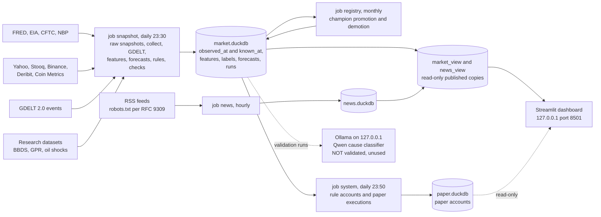

# market-signals

> **Not financial advice.** This is a personal research project with paper trading only. Nothing here is a
> recommendation to buy or sell anything. Backtest results below are **backtests, not live results**, and by the
> project's own rule they do not justify investing real money.

## The problem

Can a careful one-person system say anything useful about large short-term moves in **gold, silver, WTI/Brent crude,
bitcoin and ether** — and can it explain *why* a market moved — without fooling itself?

Most retail "signals" fail on the last part of that question: they use data that was not available at the time,
try dozens of variants and report the best, and never test on data they have not seen. This project is built around
avoiding those mistakes, and it reports what failed as plainly as what worked.

## Method

- **Point-in-time (PIT) data.** Every stored value has `observed_at` and `known_at`. A decision for day D uses only
  values with `known_at` ≤ D 22:00 UTC (`ms.db.as_of`, `ms.db.panel_asof`). Revisions are kept as separate versions.
  Tests perturb data from after D and assert that features, forecasts and decisions for D do not change
  (`tests/test_pit_next_day.py`, `tests/test_paper.py`). Late inputs (e.g. the gold/oil volatility indices GVZ/OVX)
  trigger corrections inside a 7-day window, and every correction is logged.
- **Walk-forward validation.** Forecasts are evaluated on calendar-year folds. Each fold trains only on samples whose
  5-day label ended before the fold, with a 40-day embargo (`src/ms/wf.py`). Skill is measured as the Brier skill score
  (BSS) against the base rate, with block-bootstrap confidence intervals.
- **Trial registry.** Every evaluation run is a row in the `runs` table with a hash of its full definition.
  Changing a threshold, window or test type is a *new trial*, never a silent rerun. The trial count feeds the
  multiple-testing corrections below.
- **Multiple-testing corrections.** Benjamini–Hochberg (q = 0.1) for hypotheses taken from the literature;
  Deflated Sharpe Ratio and Probability of Backtest Overfitting (PBO, CSCV) for portfolio rules.
- **Pre-registration and a holdout opened once.** Portfolio rules were hash-frozen (`d9cb3a3a2da04caa`) before the
  first computation. A test fails if the rule code changes. The two-year holdout was opened exactly once, after the
  winner had been chosen.
- **Mutation checks.** Each protective test was verified by deliberately breaking the code it guards and confirming
  the test fails ("break, restore, verify"). These are done by hand during development (there is no mutation-testing
  tool in CI), and the checks are noted in the decision log.
- **Local only.** All models, including the language model, run on one Mac. Ollama listens on 127.0.0.1 only and the
  dashboard on 127.0.0.1:8501. The network is used only to *download* public data from an allowlist
  (`src/ms/netpolicy.py`). Tests and a live check of listening sockets and connections enforce this.
- **A local LLM that classifies, never forecasts.** A Qwen model (via Ollama) may only label a text with a cause code
  (monetary, macro, oil supply, geopolitics …). It never sees prices. Before its labels could be shown anywhere it
  had to pass four pre-registered tests (E1–E4), with at most three trials.

  **It did not pass.** In the third and final trial, agreement with human coders (E1) reached Cohen's κ = 0.628
  against a threshold of 0.695, which was frozen before any model run as human–human κ (0.795) minus 0.10.
  The calendar-day test (E4-hist) scored 0/42. Diagnostics showed that this test mostly measured the input selection:
  among the 600 most-mentioned GDELT items of an FOMC or OPEC day, the median number mentioning the event was zero.
  It was still a pre-registered failure. The classifier is therefore **not used** anywhere. Calendar events are shown
  only as "on this day: …", never as causes. Full report:
  [`reports/move-causes-validation-2026-10-08.md`](reports/move-causes-validation-2026-10-08.md).

> **Language note:** code comments, docstrings, stage plans (`docs/ETAP*.md`) and reports (`reports/`) are written in
> **Polish**. This README, [`docs/DECISIONS.md`](docs/DECISIONS.md) (summary of key decisions) and
> [`DATA_SOURCES.md`](DATA_SOURCES.md) are in English.

## Architecture



Sources are download-only, from an allowlist. Jobs run under launchd, catch up after the Mac sleeps, and use `lockf`
against double runs. All DuckDB files are local and git-ignored.

Main parts (`src/`):

| area | code | what it does |
|---|---|---|
| data layer | `ms/db.py`, `ms/collectors/`, `collect.py`, `snapshot_raw.py` | collectors write versioned observations; raw files kept for sources whose history cannot be re-downloaded |
| features & labels | `ms/features.py`, `ms/labels.py`, `build_features.py` | z-scored feature groups; labels = 5-day move beyond ±1.5σ |
| forecasts | `ms/baselines.py`, `ms/models/`, `ms/wf.py`, `ms/registry.py`, `predict_daily.py` | volatility baselines, GARCH-t, LightGBM (withdrawn); registry of champions per asset |
| decomposition | `ms/decompose.py` | weekly return split into factor contributions (out-of-sample betas) |
| hypotheses | `ms/hypotheses.py`, `test_hypotheses.py` | literature claims tested with BH correction |
| portfolio rules | `ms/rules.py`, `ms/rules_eval.py`, `backtest_rules.py`, `ms/system.py` | pre-registered rules, DSR/PBO, live paper accounts |
| paper game | `ms/paper.py`, `paper.py` | paper orders executed at the next close, PLN costs and Polish tax rules (unverified) |
| causes & news | `ms/causes.py`, `ms/news.py`, `ms/classify.py`, `validate_causes.py` | calendar candidates, RSS collection, LLM classifier and its validation |
| dashboard | `dashboard/`, `ms/views.py` | every number comes from `ms.views` (provenance test) |
| operations | `tools/` | launchd templates and installer, health check, full gate `tools/bramka.sh` |

## How to run

Requirements: macOS (the jobs use launchd; the Python code itself is portable), Python 3.12, [uv](https://docs.astral.sh/uv/),
and optionally [Ollama](https://ollama.com) for the classifier.

```sh
uv sync --frozen
cp .env.example .env           # FRED_API_KEY, EIA_API_KEY; optional MS_CONTACT_EMAIL, MS_LAUNCHD_PREFIX

# tests without data: data-dependent tests are skipped with a reason
uv run --frozen pytest -q

# collect data (first run downloads history; see DATA_SOURCES.md for each source's terms)
uv run src/snapshot_raw.py
uv run src/collect.py
uv run src/build_features.py
uv run src/eval_baselines.py   # forecast baselines (stage 3A report in reports/)

# dashboard (local only)
uv run streamlit run src/dashboard/app.py --server.address=127.0.0.1 --server.port=8501

# scheduled jobs: render launchd plists from launchd/*.plist.template and load them
tools/install_launchd.sh       # uses MS_LAUNCHD_PREFIX (default local.market-signals), MS_REPO, UV
tools/health.sh                # job status, last successful run, news sources
```

- **Full gate:** `tools/bramka.sh`. It runs all checks with `MS_REQUIRE_DB=1`, so a missing database is a failure,
  not a skip, and it verifies that the live launchd/Ollama configuration matches the repo. It is meant for a machine
  with collected data and installed jobs.
- **E2 reference set:** the World Gold Council quotes are not included. Save the commentary pages listed in
  `ref/e2_wgc_index.csv` to `data/raw/wgc_gmc/`, then run `uv run src/e2_wgc_restore.py`. It checks a SHA-256 of
  every sentence.

## Results

All figures come from the reports in `reports/` (generated 2026-10-06 … 2026-10-08). They are **backtests and
validation runs, not live results.** Live paper accounts started on 2026-10-07; that is far too short to say anything.

**Forecasts of a large 5-day move** — BSS vs the base rate, 10 years, 95% CI
([`reports/baselines-eval-2026-10-06.md`](reports/baselines-eval-2026-10-06.md)). "Best" is the maximum of 3–5 models
on the same period, so it is inflated by selection.

| asset | best baseline | BSS [95% CI] | verdict |
|---|---|---|---|
| WTI | OVX, calibrated | +0.048 [+0.016, +0.080] | better than base rate |
| Brent | OVX, raw | +0.047 [+0.011, +0.078] | better than base rate |
| gold | GVZ, calibrated | +0.014 [−0.000, +0.029] | indistinguishable |
| silver | realized-vol ratio | +0.011 [−0.000, +0.023] | indistinguishable |
| BTC | GARCH(1,1)-t | +0.004 [−0.017, +0.024] | indistinguishable |
| ETH | realized-vol ratio | −0.004 [−0.008, −0.001] | worse |

- **LightGBM** did not beat the best baseline on any asset and was significantly worse on WTI, Brent, BTC and ETH,
  so it was withdrawn ([`reports/gbm-eval-2026-10-06.md`](reports/gbm-eval-2026-10-06.md)).
- **Analog search** ("find similar past days") was no better than the base rate on gold and silver, and worse on WTI,
  Brent, BTC and ETH ([`reports/analogs-eval-2026-10-06.md`](reports/analogs-eval-2026-10-06.md)).

**Rule-based portfolio (BTC, ETH, silver, WTI; 1000 PLN; costs and Polish tax included)** — development period
2016-10-06 … 2024-10-05 ([`reports/etap5-rozwoj-2026-10-07.md`](reports/etap5-rozwoj-2026-10-07.md)):

- 12 trials in the family. The pre-registered winner rule chose **equal weight of the 4 assets**, because no
  inverse-volatility variant beat it on Sharpe.
- Equal weight: Sharpe 0.86, Deflated Sharpe **0.948**, just below the 0.95 bar. Maximum drawdown −59.5%.
- PBO = 0.271 (threshold < 0.5; rough with 12 candidates).

Holdout 2024-10-06 … 2026-10-05, opened once
([`reports/etap5-odlozone-2026-10-07.md`](reports/etap5-odlozone-2026-10-07.md)). This period had been seen by earlier
stages (the momentum backtest and the OVX model choice), so it is not a pristine test.

| variant | annual return | Sharpe | max drawdown |
|---|---|---|---|
| **equal weight (winner)** | +24.7% | 0.81 | −32.5% |
| inverse vol + OVX filter | +18.4% | 0.96 | −22.1% |
| buy-and-hold gold (benchmark) | +19.9% | 1.09 | −22.0% |
| 1-month momentum (benchmark) | +65.6% | 1.12 | −39.7% (development: −75.4%) |
| deposit | +3.0% | — | 0.0% |

What this means: two years, one market regime, and a winner that did not beat simply holding gold on a risk-adjusted
basis. The momentum line shows how much a single lucky period can flatter a rule whose development drawdown was −75%.

**Cause classifier (local LLM)** — not validated after three trials
([`reports/move-causes-validation-2026-10-08.md`](reports/move-causes-validation-2026-10-08.md)):

| test | trial 3 result | threshold | pass |
|---|---|---|---|
| E1 — newspaper passages coded by humans (BBDS 1950–2022, n = 492) | κ 0.628 [0.561; 0.686], accuracy 0.701 | κ ≥ 0.695 | no |
| E2 — World Gold Council monthly commentary (n = 30) | accuracy 0.800, κ 0.729; masked names/dates 0.767, κ 0.681 | accuracy ≥ 0.75, κ ≥ 0.60 (both variants) | yes |
| E3 — oil episodes from the literature (control) | 4/7 | control only | — |
| E4-hist — 42 calendar days (FOMC, OPEC, hacks, ETF), full GDELT | 0/42 [Wilson 0.000; 0.084] | ≥ 0.60 | no |

## License

Code and text in this repository: [PolyForm Noncommercial License 1.0.0](LICENSE).

Required Notice: Copyright 2026 grzemiz-stack (https://github.com/grzemiz-stack)

Third-party data is **not included** and is not covered by this license. See [`DATA_SOURCES.md`](DATA_SOURCES.md).
